# 🏗️ Architecture & Component Workflow: octocat/Hello-World

> **Commit SHA:** `main`  
> **Status:** Grounded from verified repository files

## 1. Component Interaction Diagram

```mermaid
graph TD
    User([Developer / Contributor]) --> Entry["Entrypoint/CLI"]
    Entry --> Core[Core Application Logic]
    Core --> Config[Configuration & Environment]
    Core --> Tests["Automated Tests (0 files)"]
    classDef verified fill:#1e293b,stroke:#3b82f6,stroke-width:2px;
    class Entry,Core,Config,Tests verified;
```

## 2. Execution Dataflow
1. **Invocation:** User or runtime triggers `Entrypoint/CLI`.
2. **Configuration Loading:** Defaults and environment variables are parsed into the configuration object.
3. **Execution:** Core modules perform processing and dispatch responses or operations.
4. **Verification:** Unit tests assert output invariants and handle edge cases.
